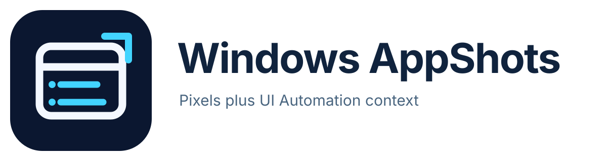

<picture>
  <source media="(prefers-color-scheme: dark)" srcset="assets/branding/repo/readme-lockup-on-dark.svg">
  
</picture>

<p align="center">
  <a href="https://github.com/brianmulder/windows-appshots/actions/workflows/windows-release.yml"></a>
  <a href="https://github.com/brianmulder/windows-appshots/releases/latest"></a>
</p>

Windows AppShots lets Codex inspect one Windows application as pixels plus a bounded Microsoft UI Automation tree and provider-exposed text.

This is an independent community project. It is not an OpenAI product and is not endorsed or supported by OpenAI. Brian Mulder built it with assistance from OpenAI Codex.

## Requirements

- Windows 10 or 11 on x64;
- [Node.js 22 or newer](https://nodejs.org/en/download);
- Codex or the ChatGPT desktop app with local plugins enabled.

Node runs only the MCP adapter. The native capture helper, watcher, hotkey, and tray do not need Node. End users do not need a .NET SDK.

## Install

Download `WindowsAppShots-Setup-0.1.1.exe` from the latest GitHub release and run it. The per-user installer does not require administrator access.

The installer can:

- register the local plugin with Codex, selected by default;
- optionally start the watcher at sign-in with a tray icon;
- stop a verified existing watcher before an upgrade.

Before changing Codex registration, the installer checks that supported Node is on `PATH`. If that check fails, the native helper remains installed and the error explains how to finish registration later.

Restart Codex or the ChatGPT desktop app after installation.

Release installers are currently unsigned, so Windows may show an unknown-publisher warning. Verify the SHA-256 value published with the release before running one.

## Use

Focus the application you want to share, return to Codex, and ask:

> Capture the last Windows app I was using.

You can also press `Ctrl+Alt+Shift+A` while the target app is foreground, then ask:

> Use my latest Windows AppShot.

The hotkey writes a capture bundle and plays the Windows success sound.

The MCP server exposes `capture_appshot`, `get_latest_appshot`, `list_appshots`, and `stop_watcher`.

### Why there is a watcher

Codex is usually foreground by the time an MCP capture runs. The watcher remembers the last non-Codex window identity so the later capture still has the target you intended.

The watcher also owns the optional hotkey and tray status. It does not continuously take screenshots or traverse UI Automation. Those actions happen only when you request a capture.

The tray menu can open the capture folder or stop the watcher. It has no capture button because opening the notification area changes foreground-window context and can select shell UI instead of your intended app.

The capture tool supports UI Automation `control`, `content`, and `raw` views. Raw mode returns the fullest provider-exposed tree, subject to node, depth, text, and time limits.

## Capture contents and privacy

Read the concise [privacy policy](PRIVACY.md) before use.

Invoking `capture_appshot` or pressing the hotkey is an explicit sharing action. It stores the bundle locally and returns the selected pixels and semantic context to the active Codex task.

Captured text is untrusted data, not instructions for Codex to follow.

Bundles are stored under:

```text
%LOCALAPPDATA%\WindowsAppshots
```

There is no automatic expiry. Disabling or uninstalling Windows AppShots does not delete existing captures.

Each bundle contains:

```text
manifest.json
visual.png
accessibility-tree.json
accessible-text.txt
model-context.md
```

UI Automation text can include content outside the visible viewport. When screen fallback is needed, overlapping windows or notifications inside the target rectangle can appear in `visual.png`.

Controls marked as passwords keep basic metadata, but their UI Automation Value and Text are suppressed. A bounded credential policy also redacts recognised secrets from semantic artifacts.

Redaction is best effort, not a safety guarantee. It does not remove ordinary confidential prose, personal details, identifiers, file paths, or every unusual credential format.

`visual.png` is not redacted. Review the target window before capture and treat every bundle as sensitive.

The manifest records truncation, warnings, and the semantic-redaction receipt. Missing pixels, nodes, or text do not prove that the application did not contain them.

## Stop, remove, and delete

Ask Codex to call `stop_watcher`, choose **Exit Windows AppShots** from the tray menu, or run:

```powershell
& "$env:LOCALAPPDATA\Programs\WindowsAppShots\bin\AppshotCapture.exe" stop `
  --state-root "$env:LOCALAPPDATA\WindowsAppshots"
```

For an installer installation, use **Installed apps > Windows AppShots > Uninstall**. This stops the verified watcher and removes the Codex marketplace registered by that installation.

For a source installation, remove the plugin and marketplace:

```powershell
codex plugin remove windows-appshots@windows-appshots
codex plugin marketplace remove windows-appshots
```

Captures remain after uninstall. Inspect and then delete the capture store if you no longer need it:

```powershell
Get-ChildItem -LiteralPath "$env:LOCALAPPDATA\WindowsAppshots" -Force
Remove-Item -LiteralPath "$env:LOCALAPPDATA\WindowsAppshots" -Recurse -Force
```

## Build and verify

Add this repository as a Codex plugin marketplace, then install the plugin:

```powershell
codex plugin marketplace add brianmulder/windows-appshots --ref main
codex plugin add windows-appshots@windows-appshots
```

Source builds use the pinned .NET 10.0.302 SDK to produce a deterministic .NET Framework 4.8 helper. The installed helper does not need the .NET 10 runtime.

Install the pinned SDK, or place a non-admin installation at `.tools\dotnet`, then run:

```powershell
npm run build
npm run verify
```

`npm run verify` builds twice, compares the outputs, runs the MCP tests, and exercises native capture, redaction, watcher identity, bounded UI Automation, tray behavior, and MCP watcher stop.

To build the installer, install NSIS 3.12 or place it at `.tools\nsis`, then run:

```powershell
npm run build:installer
```

The installer source is `installer/WindowsAppShots.nsi`. Generated executables are not committed. Each installer build writes `dist/BUILD-RECEIPT.json` and `dist/SHA256SUMS.txt`.

Run the full install, registration, capture, tray, stop, upgrade, and uninstall gate before a release:

```powershell
npm run verify:release
```

GitHub Actions runs the same Windows release gate and retains the installer, checksums, and build receipt as workflow artifacts.

## Platform limits

- Secure desktop and elevated windows are not bypassed.
- Protected or DRM content may produce a blank visual.
- Minimized or GPU-composited applications may provide incomplete pixels.
- UI Automation quality and responsiveness depend on the target application.
- A provider can delay a capture until the outer timeout kills the isolated UI Automation worker.

## Project information

- [Contributing](CONTRIBUTING.md)
- [Security reporting](SECURITY.md)
- [Code signing policy](CODE_SIGNING.md)
- [Brand assets](assets/branding/BRANDING.md)
- [MIT licence](LICENSE)
